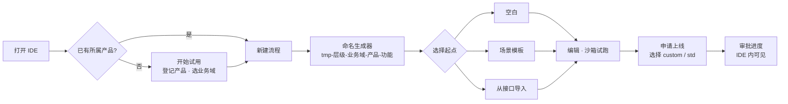

# v1.3.0「自助接入」设计

> 状态：设计待确认 · 目标发布 2026-11-13 · 路线图见 `docs/roadmap.md`
> 关联：《流程库服务端配合方案》《流程库服务端 AI 实施指南》第九节（命名规范、产品登记、自助试用）、《编排平台推广计划》

## 1. 目标

让一个**从未接触过平台**的团队，在测试环境里**自己**完成：登记产品 → 按规范命名并建出第一个流程 → 接上自己已有的接口 → 试跑 → 申请上线。平台方不陪跑也能走通，推广计划里的"首跑"就能批量发生。

SDK 侧只做交互与编排；身份、权限、产品登记、上线审批都由宿主经扩展点接入治理服务。不接这些扩展点时，SDK 行为与 1.2.0 完全一致。

| 能力 | 解决的阻碍 | 服务端依赖 |
|---|---|---|
| 扩展点注册机制 `IdeProviders` | 宿主接入分散、每加一个能力就要改两处 props | 无 |
| 自助接入向导 + 命名生成器 + 申请上线 | 权限摩擦、学习门槛、命名不规范 | 自助试用、产品、上线申请接口（指南 9.4） |
| 接口导入 | 迁移成本 | 无（登记为库能力属 v1.4.0） |
| 接入埋点 `TelemetrySink` | 推广进度靠手工统计 | 事件接收接口 |

## 2. 扩展点注册机制

### 2.1 问题

1.2.0 的扩展点以 props 形式分别挂在 `WorkflowIDE` 与 `AiWorkflowIDE` 上，同一个 `libraryProvider` 要传两次；后续还要增加 Onboarding、Telemetry、Review、Template、ExecutionSample，props 会越来越多，宿主也容易漏传。

### 2.2 方案

新增统一的 `IdeProviders` 对象与上下文组件，宿主配置一次，页面内所有 IDE 实例共用：

```ts
export interface IdeProviders {
  library?: LibraryProvider;          // 1.2.0 已有
  onboarding?: OnboardingProvider;    // 1.3.0
  telemetry?: TelemetrySink;          // 1.3.0
  // 预留：review?、templates?、executionSamples?（1.4.0 / 1.5.0）
}

<WorkflowIdeProvider providers={providers}>
  <WorkflowIDE … />
  <AiWorkflowIDE … />
</WorkflowIdeProvider>
```

- **解析顺序**：组件 prop（如 `libraryProvider`）> 组件 `providers` prop > 外层 `WorkflowIdeProvider` > 无。现有 `libraryProvider` prop 保留，行为不变。
- **稳定性**：`providers` 对象变化时按字段比较，只有某个 provider 引用变化才重新加载对应数据（避免宿主每次渲染新建对象导致目录重载）。
- **能力探测**：每个功能自己检查对应 provider 是否存在，不存在就不显示入口（例如没有 `onboarding` 就不出现"开始试用"）。
- **Demo**：`createMockProviders()` 一次提供全部模拟实现。

## 3. 自助接入向导

### 3.1 用户流程



### 3.2 `OnboardingProvider` 契约

与《AI 实施指南》9.4 的接口一一对应：

```ts
export interface OnboardingContext {
  env: 'TEST' | 'PROD';
  user: { id: string; name: string };
  /** 当前环境是否开放自助试用（生产为 false） */
  trialEnabled: boolean;
}

export interface ProductInfo {
  name: string;               // 名称中的"产品"段，不含 "-"
  domain: string;             // 业务域
  status: 'PENDING' | 'ACTIVE';
  role: 'OWNER' | 'MEMBER';
}

export type StartTrialResult =
  | { status: 'ok'; product: ProductInfo }
  | { status: 'conflict'; owners: { id: string; name: string }[] };   // 产品已存在且当前用户非成员

export interface PromotionStatus {
  requestId: string;
  state: 'SUBMITTED' | 'REVIEWING' | 'APPROVED' | 'REJECTED' | 'SYNCED';
  targetName?: string;        // 生产中的正式名称（类型段已替换）
  comment?: string;
  updatedAt: string;
}

export interface OnboardingProvider {
  getContext(signal?: AbortSignal): Promise<OnboardingContext>;
  listDomains(signal?: AbortSignal): Promise<string[]>;                 // GET /api/library/domains
  listMyProducts(signal?: AbortSignal): Promise<ProductInfo[]>;         // GET /api/products/mine
  startTrial(input: { productName: string; domain: string; systemCode?: string }): Promise<StartTrialResult>; // POST /api/onboarding/trial
  requestPromotion(input: { workflowName: string; version: number; targetType: 'custom' | 'std' }): Promise<{ requestId: string }>; // POST /api/onboarding/promote
  getPromotion(requestId: string, signal?: AbortSignal): Promise<PromotionStatus>;                // GET /api/onboarding/promote/{id}
}
```

### 3.3 组件

| 组件 | 说明 | 可单独使用 |
|---|---|---|
| `WorkflowNameBuilder` | 五段式命名：类型（试用时固定 `tmp`）、层级、业务域（取所属产品）、产品（下拉我的产品）、功能（自由输入，`snake_case` 提示）；实时预览完整名称并用 `validateWorkflowName` 校验 | ✅ |
| `OnboardingWizard` | 3 步弹窗：产品 → 命名 → 起点；完成后用生成的骨架 `WorkflowDef` 调 `setWorkflow` | ✅ |
| `PromotionPanel` | 工具栏"申请上线"：选择目标类型、预览正式名称、提交、轮询进度（指数退避，30 秒封顶） | ✅ |

- **入口**：有 `onboarding` 时，IDE 工具栏出现"新建流程"（打开向导）；`trialEnabled` 且用户无所属产品时，空画布显示"开始试用"引导卡片。
- **骨架定义**：`name`、`description`（来自功能说明）、`version: 1`、`schemaVersion: 2`、`ownerEmail`（宿主可通过 context 提供）、空 `tasks`；层级写入 `currentWorkflowLevel`，动作选择器随之按分层规则过滤。
- **保存校验**：`onSave` 前用 `validateWorkflowName` 提示命名问题（不阻断，由服务端做权威校验）。

### 3.4 失败与降级

- 任一接口失败：向导停在当前步并显示"重试"，已填内容保留。
- `startTrial` 返回 `conflict`：提示"产品已存在，请联系负责人加入"，列出负责人。
- 生产环境（`trialEnabled = false`）：不出现"开始试用"，"新建流程"的类型段可选 `custom` / `std`。

## 4. 接口导入

### 4.1 支持的来源

| 来源 | 1.3.0 | 说明 |
|---|---|---|
| OpenAPI 3.x（JSON） | ✅ | 选择一个或多个 operation |
| Swagger 2.0（JSON） | ✅ | |
| Postman Collection v2.1（JSON） | ✅ | |
| curl 命令 | ✅ | 解析方法、URL、头、`-d` / `--data-raw` 请求体 |
| YAML 格式的 OpenAPI | ⏸ 待定 | 需要引入 YAML 解析依赖，见第 7 节 |

### 4.2 生成结果

每个选中的接口生成一个**业务动作**并插入当前流程：

- 编译为 Conductor `HTTP` 任务：`http_request.uri / method / headers / body`，路径参数与查询参数转为 `${...}` 可插入数据的字段。
- 表单字段来自 parameters / requestBody schema（沿用 `buildFields` 的规则：`title` → 中文名，`enum` → 下拉），出参来自 2xx 响应 schema（沿用 `buildOutputs`）。
- **敏感头不落定义**：`Authorization`、`Cookie`、`X-*-Token` 等头的值替换为 `${workflow.input.xxx}` 占位，并在导入面板提示改用凭据管理。
- 导入结果仅存在于当前流程（以及本会话的动作库）；**登记为流程库能力**需要审核，放到 v1.4.0 与发布审核流一起做。

### 4.3 交互

工具栏"导入接口" → 粘贴或上传 → 预览接口列表（方法、路径、摘要，可多选）→ 确认插入。解析为纯函数（`parseOpenApi` / `parsePostman` / `parseCurl` → `ImportedOperation[]` → `buildHttpAction`），全部可单测。

## 5. 接入埋点

### 5.1 `TelemetrySink`

```ts
export interface IdeEvent {
  name: IdeEventName;
  at: number;                         // epoch ms
  ide: 'workflow' | 'ai';
  workflowName?: string;              // 不含任何参数值
  props?: Record<string, string | number | boolean>;
}

export interface TelemetrySink {
  track(events: IdeEvent[]): void | Promise<void>;   // SDK 侧批量（5 秒或 20 条），页面隐藏时 flush
}
```

### 5.2 事件（首批）

| 事件 | 触发 | 用途 |
|---|---|---|
| `ide_opened` | IDE 挂载 | 活跃度 |
| `trial_started` | 向导完成产品登记 | 漏斗：开始试用 |
| `workflow_created` | 向导生成骨架 | 漏斗：首份草稿 |
| `step_added` | 插入步骤（`props.source`: builtin / library / import / template） | 能力复用情况 |
| `api_imported` | 接口导入（`props.count`、`props.format`） | 接口导入使用率 |
| `sandbox_run` | 本地沙箱试跑（`props.result`） | 漏斗：首次试跑 |
| `workflow_saved` | 触发 `onSave` | |
| `promotion_requested` / `promotion_state` | 申请上线 / 状态变化 | 漏斗：上线 |
| `ai_event` | 透传现有 `onAiEvent` 的类型（不含内容） | AI 使用情况 |

- **不采集**：参数值、表达式、提示词、对话内容、执行数据。
- `onAiEvent` / `onAiMetrics` 保持不变；`TelemetrySink` 存在时额外转发。
- 生产首跑（KPI 口径）由服务端按执行数据判定，SDK 不上报"首跑成功"。

## 6. 兼容性

- 全部新增能力默认关闭，依赖对应 provider 才显示入口。
- 不改变任何现有 props 的含义；`libraryProvider` prop 与 `providers.library` 并存。
- 新增导出：`WorkflowIdeProvider`、`IdeProviders`、`OnboardingProvider` 及相关类型、`WorkflowNameBuilder`、`OnboardingWizard`、`PromotionPanel`、`TelemetrySink`、`IdeEvent`、接口导入的解析函数；`/ai` 入口同步导出。

## 7. 待确认

1. **YAML 支持**：是否允许为接口导入新增 `yaml` 依赖（约 30 KB gzip 前，按需动态加载）？不允许则 1.3.0 只支持 JSON 与 curl。
2. **向导入口**：除工具栏"新建流程"外，是否在空画布自动显示"开始试用"引导？（建议：是，仅测试环境且用户无所属产品时）
3. **埋点粒度**：首批事件是否足够？是否需要按页面停留时长等更细的指标？（建议：先首批，灯塔陪跑后再加）
