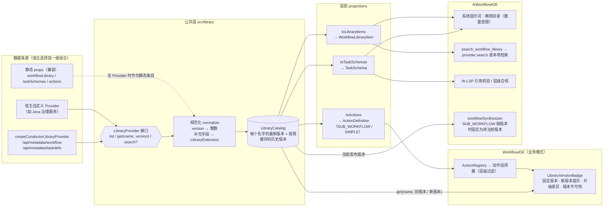

# 流程库数据源（LibraryProvider）设计

> 状态：已实现（P1–P4） · 适用版本：v1.2.0 起
> 关联决策：元数据采用 Conductor OSS 标准结构；流程库能力首次引用时固定版本，库升级不自动跟随。

## 1. 背景与问题

同一批"标准通用能力"，目前要由宿主分别喂给三个入口，彼此不知道对方：

| 现有来源 | 位置 | 内容 | 消费方 |
|---|---|---|---|
| `actions` prop | `WorkflowIDE` → `ActionRegistry` | `ActionDefinition`（可由 `buildActionsFromLibrary` 从 `WorkflowDef` 生成） | 业务模式动作选择器 |
| `workflowLibrary` prop | `AiWorkflowIDE` → `libraryStore` | `WorkflowLibraryItem`（L1/L2/L3、版本**字符串**、描述、标签） | 系统提示词目录、`search_workflow_library`、`LibraryPanel`、层级校验 |
| `taskSchemas` prop | `AiWorkflowIDE` → `schemaRegistry`（全局单例） | 任务名 → 入参/出参简化类型串 | 系统提示词、W-LSP 引用校验 |

问题：

1. **三份数据易漂移**：业务模式能选的流程，AI 不知道；参数名、版本不一致。
2. **没有远程数据源**：都是静态 prop，宿主要自己拉 Conductor 元数据再转换三遍。
3. **AI 不遵守版本固定**：`workflowSynthesizer` 对 `SUB_WORKFLOW` 缺省填 `version: t.version ?? 1`，既不是库当前版本，也不是用户记录的版本。
4. **规模**：治理平台有 1000+ 工作流，不能全量塞进系统提示词或一次性渲染。

## 2. 目标 / 非目标

**目标**
- 一个公共的 `LibraryProvider` 接口，两个 IDE 共用；一份规范化数据，投影成三种消费形态。
- 内置一个可选的 Conductor OSS 默认实现；宿主也可自己实现（如由 Java 治理服务提供）。
- 业务模式与 AI 生成都遵守"首次引用固定版本"。
- 现有 `actions` / `workflowLibrary` / `taskSchemas` 三个 prop 行为不变（兼容）。

**非目标**
- 不在组件库里保存凭据或做鉴权；认证头由宿主注入。
- 不负责发布、编辑库内工作流（只读）。

## 3. 总体架构



要点：**来源可换，数据只有一份，消费方只读投影**。版本固定由 `BusinessStep.libraryRef` 与 `SUB_WORKFLOW.subWorkflowParam.version` 承载，目录只告诉消费方"当前最新是几"。

## 4. 接口设计

### 4.1 Provider（`src/library/types.ts`）

```ts
export interface LibraryExtension {          // Conductor 标准之外的补充字段
  level?: WorkflowLevel;                     // L1 / L2 / L3
  category?: string;
  icon?: string;
  tags?: string[];
  displayName?: string;
  /** 透传到 ActionExtension（字段级覆盖等） */
  action?: ActionExtension;
}

export interface LibraryWorkflowRecord {
  def: WorkflowDef;                          // Conductor 标准 WorkflowDef（含 version: number）
  extension?: LibraryExtension;
  /** 宿主侧可读版本号（如 "1.2.0"），仅展示用 */
  versionLabel?: string;
  /** 已下线 / 不建议新引用 */
  deprecated?: boolean;
}

export interface LibraryTaskRecord {
  def: RegisteredTaskDef;                    // Conductor 标准 TaskDef
  extension?: LibraryExtension;
}

export interface LibraryListResult {
  workflows: LibraryWorkflowRecord[];        // 每个 name 只需最新版本；可只含摘要（tasks 可为空）
  tasks?: LibraryTaskRecord[];
}

export interface LibraryProvider {
  /** 列出目录（每个流程的最新发布版本） */
  list(signal?: AbortSignal): Promise<LibraryListResult>;
  /** 取指定版本的完整定义；version 缺省为最新。找不到返回 null（不抛错） */
  get(name: string, version?: number, signal?: AbortSignal): Promise<LibraryWorkflowRecord | null>;
  /** 可选：服务端检索，大目录时由 AI 工具与选择器使用 */
  search?(query: string, opts?: { level?: WorkflowLevel; limit?: number }, signal?: AbortSignal):
    Promise<LibraryWorkflowRecord[]>;
}
```

### 4.2 规范化与目录（`src/library/catalog.ts`）

```ts
export interface LibraryEntry {
  name: string;
  version: number;                 // 统一为整数
  versionLabel?: string;
  description?: string;
  level?: WorkflowLevel;
  tags: string[];
  deprecated: boolean;
  record: LibraryWorkflowRecord;
}

export class LibraryCatalog {
  constructor(provider?: LibraryProvider, options?: { staticItems?: WorkflowLibraryItem[]; staticTaskSchemas?: TaskSchema[] });
  load(signal?: AbortSignal): Promise<void>;     // 拉目录，去重取每个 name 的最大 version
  latest(name: string): LibraryEntry | undefined;
  getVersion(name: string, version: number): Promise<LibraryWorkflowRecord | null>; // 历史版本按需取并缓存
  entries(): LibraryEntry[];
  subscribe(listener: () => void): () => void;   // 供 React useSyncExternalStore
}
```

版本规范化规则：

| 输入 | 结果 |
|---|---|
| `WorkflowDef.version` 为整数 | 原样使用 |
| 静态 `WorkflowLibraryItem.version` 为 `"3"` | `3`，`versionLabel` 为 `"3"` |
| 静态 `"1.2.0"` 等无法解析为整数 | `version` 取 `parseInt` 主版本号；`versionLabel` 保留原串，并在控制台告警一次 |

### 4.3 投影（`src/library/projections.ts`）

| 函数 | 输出 | 说明 |
|---|---|---|
| `toActions(catalog)` | `ActionDefinition[]` | 复用 `buildActionFromWorkflowDef` / `buildActionFromTaskDef`；`extension` 映射为 `ActionExtension` |
| `toTaskSchemas(catalog)` | `TaskSchema[]` | 由 `inputSchema.properties` / `outputSchema.properties` 展开为类型串；`enum` 输出为 `a\|b`；无 schema 时退回 `inputKeys` |
| `toLibraryItems(catalog)` | `WorkflowLibraryItem[]` | 供提示词目录、检索工具与 `LibraryPanel`；`version` 输出为字符串以兼容旧类型 |

### 4.4 默认 Conductor 实现（`src/library/conductorProvider.ts`）

```ts
createConductorLibraryProvider({
  baseUrl: 'https://conductor.example.com/api',
  headers: () => ({ Authorization: `Bearer ${token}` }), // 宿主注入，组件库不存
  fetch?: typeof fetch,
  includeTaskDefs?: boolean,                               // 默认 false
  filter?: (def: WorkflowDef) => boolean,                  // 只暴露"流程库"内的工作流（如按名前缀 / ownerEmail）
  resolveExtension?: (def: WorkflowDef) => LibraryExtension | undefined, // 补充字段来源由宿主决定
  paths?: { workflows?: string; workflow?: string; taskDefs?: string },  // 网关路径不同可覆盖
});
```

- 默认路径：`GET {baseUrl}/metadata/workflow`、`GET {baseUrl}/metadata/workflow/{name}?version={v}`、`GET {baseUrl}/metadata/taskdefs`。
- 列表接口可能返回同名多版本，客户端按 `name` 取最大 `version`。
- 404 → `get` 返回 `null`；网络错误抛出，由目录层捕获为 `error` 状态。
- 不内置 `search`（Conductor OSS 元数据接口无检索）；宿主自定义 Provider 可实现。

## 5. 集成方式

### 5.1 Props（两个 IDE 一致）

```tsx
const provider = createConductorLibraryProvider({ baseUrl, headers, filter, resolveExtension });

<WorkflowIDE   libraryProvider={provider} />
<AiWorkflowIDE libraryProvider={provider} />
```

- 优先级：同名条目 **Provider > 静态 prop**；静态 prop 仍可单独使用。
- `libraryProvider` 引用变化时重新加载；组件卸载时 `abort` 进行中的请求。
- 加载状态（`idle / loading / ready / error`）通过目录暴露；动作选择器与 `LibraryPanel` 显示"加载中 / 加载失败，点击重试"，失败不阻塞编辑。

### 5.2 业务模式

- `toActions` 结果注册到该实例的 `ActionRegistry`（同名先 `unregister`）。
- **层级过滤**：`WorkflowIDE` 新增可选 `currentWorkflowLevel`；提供时，动作选择器隐藏违反层级规则的流程库动作（L1 不显示 L2/L3，L2 不显示 L3），未提供则不过滤。
- `deprecated` 条目不出现在选择器中，但已引用的步骤照常显示与编译。

### 5.3 AI IDE

- `libraryStore.setLibrary(toLibraryItems(...))` 与原逻辑合并；`schemaRegistry` 合并 `toTaskSchemas(...)`。
- **提示词体积**：目录注入上限 `promptCatalogLimit`（默认 50 条，按层级 L3→L1 截断），超出部分在提示词中写明"另有 N 个，请调用 `search_workflow_library`"。
- `search_workflow_library`：有 `provider.search` 时走服务端，否则在目录内本地匹配。
- **版本固定（修复）**：`workflowSynthesizer` 规范化 `SUB_WORKFLOW` 时，若无 `subWorkflowParam.version`，取 `catalog.latest(name)?.version`；目录中也没有时保持原行为并给出提示。已有版本号一律不改。

## 6. 版本固定与升级

| 场景 | 行为 |
|---|---|
| 新建步骤（业务模式 / AI） | 记录目录中当前最新版本：`libraryRef.version` / `subWorkflowParam.version` |
| 库发布新版本 | 步骤仍编译到固定版本；徽标显示「⬆ 有新版本 vN」 |
| 用户点击升级 | 取旧版本与新版本定义，展示**升级差异**后确认（见下） |
| 固定版本在库中不存在 / 已下线 | 徽标显示「⚠ 版本不可用」，保持原样编译，不自动改版本 |
| 目录加载失败 | 不显示新版本提示，不影响编辑与编译 |

**升级差异**（`src/library/diff.ts`，纯函数）：

```ts
diffWorkflowVersions(oldDef, newDef, filledValues): {
  addedInputs: Field[];      // 新增入参（标出 required）
  removedInputs: Field[];    // 删除的入参（若已填值，标记"值将丢失"）
  changedInputs: { key; from; to }[];  // 类型 / enum 变化
  addedOutputs: string[];
  removedOutputs: string[];  // 若被下游步骤引用，标记"下游引用将失效"
}
```

确认框按"会影响已填内容"的条目置顶显示；无差异时提示"入参出参未变化"。

## 7. 编排系统需要配合的事项

1. **维护 `inputSchema` / `outputSchema`**：否则退回 `inputKeys` + `inputTemplate` 推断，类型、必填、枚举信息丢失。
2. **补充字段的存放位置**：层级、分类、图标等由宿主通过 `resolveExtension` 或自定义 Provider 提供（扩展表、命名约定或治理服务均可）。
3. **流程库范围**：约定哪些工作流属于"流程库"（名前缀、`ownerEmail` 或治理服务标记），供 `filter` 使用。
4. **接口可达**：元数据接口需支持跨域，或经网关转发。
5. **（可选）检索接口**：目录很大时，治理服务提供 `search`，AI 与选择器即可走服务端检索。

## 8. 实施批次

| 批次 | 内容 | 验收 |
|---|---|---|
| P1 公共层 | `src/library/`：类型、规范化、`LibraryCatalog`、三种投影；单测 | 版本规范化、去重取最新、投影结果、历史版本缓存测试通过 |
| P2 接入 | 两个 IDE 的 `libraryProvider` prop；动作注册；AI 目录 / schema 合并；提示词上限；检索工具；`workflowSynthesizer` 版本固定修复；层级过滤 | 不传新 prop 时现有测试全部通过；新增集成单测 |
| P3 默认实现 | `createConductorLibraryProvider`（注入 `fetch` 测试） | 路径、去重、404、headers、filter、resolveExtension 测试 |
| P4 升级体验 | `diffWorkflowVersions`；徽标升级差异确认；「版本不可用」状态 | 差异算法单测；徽标状态单测 |

所有新导出从 `src/index.ts` 暴露，并在 CHANGELOG `[Unreleased]` 记录。
